<h1 align="center">Olá, eu sou o Lucas 👋</h1>

<i>Desenvolvedor Backend • Java & Spring Boot • Em busca de estágio ou vaga júnior</i>

---

  Gosto de construir APIs que resolvem problemas reais, com a regra de negócio no lugar certo,
  testes que usam o banco de verdade e cuidado com segurança desde o início.

  
  <!-- LinkedIn: troque SEU-USUARIO e tire este comentário
  
  -->
  <!-- Site/portfólio: troque o endereço e tire este comentário
  
  -->

  

---

### 🧠 Sobre mim

- ⚙️ Backend com **Java e Spring Boot**: APIs REST, PostgreSQL e integrações com serviços externos
- 🌱 Estudando agora: multi-tenancy, concorrência e como levar uma API para produção
- 🎯 Em busca de **estágio ou vaga júnior** em desenvolvimento backend

### 🛠️ Stack

      

 

<i>Código que funciona, testes que provam.</i> 🟩

